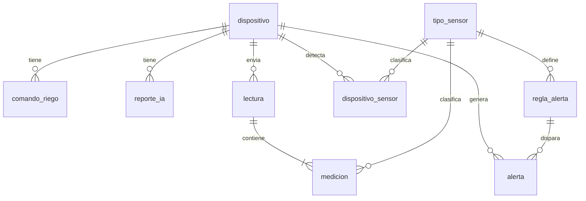

# AgroIoT — Modelo de datos y contrato de API

Versión del 15 de octubre de 2026. Fuente de verdad del proyecto: si el código y este documento no coinciden, se corrige el código o se actualiza este documento avisando al grupo.

## Principio de diseño: funciona con lo que esté armado

El sistema funciona desde el primer sensor. Cada lectura trae solo las mediciones que el ESP32 pudo leer, y la API, la base de datos, el dashboard y la IA trabajan con las que lleguen. Tres reglas lo garantizan:

1. **Firmware:** lee cada sensor por separado. Si uno falla (por ejemplo, el DHT22 devuelve `NaN`) o no está conectado, lo omite del JSON. Nunca envía `0` ni `null` para rellenar.
2. **API y base de datos:** aceptan cualquier subconjunto no vacío de mediciones. Cada medición es una fila en la tabla `medicion`, así que agregar o perder un sensor no cambia el esquema ni el contrato.
3. **Frontend e IA:** dibujan tarjetas, gráficas y reportes a partir de los sensores que tienen datos (la lista `sensores` de la API y los nodos de Firebase), nunca de una lista fija de cuatro.

| Lo que esté armado | Dashboard en vivo | Riego automático | Riego manual | Alertas | Reporte de IA |
| --- | --- | --- | --- | --- | --- |
| Todo | Los 4 valores | Sí | Sí | Todas | Completo |
| Sensor de suelo + relé y bomba | Humedad del suelo | Sí | Sí | Suelo seco o saturado | Centrado en el riego |
| Solo sensor de suelo | Humedad del suelo | No | No (botón deshabilitado) | Suelo seco o saturado | Centrado en el suelo |
| Solo DHT22 (+ bomba opcional) | Temperatura y humedad del aire | No | Solo si hay bomba | Temperatura, humedad del aire | Ambiental |
| Solo LDR (+ bomba opcional) | Luz | No | Solo si hay bomba | Ninguna por defecto | Limitado a la luz |

Sin ningún sensor armado, el simulador hace de ESP32 y todo funciona igual, incluido el riego: el simulador recibe el comando y lo confirma.

## Convenciones

| Código (`tipo`) | Qué mide | Unidad | Rango válido | Componente |
| --- | --- | --- | --- | --- |
| `HUMEDAD_SUELO` | Humedad del suelo | % | 0 a 100 | Sensor capacitivo v1.2 |
| `TEMPERATURA` | Temperatura del aire | °C | −10 a 60 | DHT22 |
| `HUMEDAD_AIRE` | Humedad relativa del aire | % | 0 a 100 | DHT22 |
| `LUZ` | Intensidad de luz | % | 0 a 100 | Módulo LDR |

- **La conversión se hace en el firmware:** el ESP32 envía porcentajes, no valores crudos del ADC (suelo: 0 % = seco, 100 % = sumergido; luz: 0 % = oscuridad, 100 % = luz directa).
- **Valores:** números con hasta 2 decimales.
- **Fechas en la API:** ISO-8601 en UTC con `Z` (`2026-10-16T16:20:05Z`). El frontend las convierte a hora de Guatemala para mostrarlas.
- **Fechas en Firebase:** milisegundos desde 1970 (número).
- **Nombres:** camelCase en el JSON (`dispositivoId`) y snake_case solo dentro de PostgreSQL (`dispositivo_id`). Los códigos de tipo, estado y error van en MAYÚSCULAS.
- **Dispositivo:** un identificador de texto fijo, `maceta-01`.
- **Clave del dispositivo:** los endpoints que usa el ESP32 llevan el encabezado `X-Api-Key`. El valor vive en una variable de entorno (`DEVICE_API_KEY`) y en el firmware, nunca en el repositorio.

Todos los errores tienen la misma forma:

```json
{
  "codigo": "RIEGO_EN_CURSO",
  "mensaje": "Ya hay un riego pendiente para maceta-01",
  "timestamp": "2026-10-16T16:20:05Z"
}
```

| HTTP | Cuándo se usa |
| --- | --- |
| 200 | Consulta o actualización correcta |
| 201 | Se creó algo (lectura, reporte) |
| 202 | Riego aceptado y en cola para el dispositivo |
| 400 | JSON inválido o faltan campos obligatorios (`VALIDACION`) |
| 401 | Falta `X-Api-Key` o es incorrecta (`NO_AUTORIZADO`) |
| 404 | El dispositivo, comando, alerta o reporte no existe (`DISPOSITIVO_NO_ENCONTRADO`, `COMANDO_NO_ENCONTRADO`, `ALERTA_NO_ENCONTRADA`, `REPORTE_NO_ENCONTRADO`) |
| 409 | El estado no lo permite (`RIEGO_EN_CURSO`, `BOMBA_NO_DISPONIBLE`, `COMANDO_NO_ENVIADO`) |
| 422 | Petición válida pero sin datos suficientes (`SIN_MEDICIONES_VALIDAS`, `DATOS_INSUFICIENTES`) |
| 501 | Endpoint definido pero aún no implementado (`NO_IMPLEMENTADO`). Desde la fase 7 todos están implementados y ninguno lo responde |
| 502 | Falló el servicio de IA (`IA_NO_DISPONIBLE`) |

## PostgreSQL: el historial

Son nueve tablas y una vista. El script completo está en `db/schema.sql` (probado en PostgreSQL 16) y las consultas que usa la API en `db/consultas.sql`.



| Tabla | Para qué sirve | Quién escribe en ella |
| --- | --- | --- |
| `tipo_sensor` | Catálogo de los 4 tipos con su unidad y rango válido | Datos iniciales del script |
| `dispositivo` | La maceta y su configuración de riego (umbral 35 %, 5 s, 10 min de espera) | El script; la API al cambiar la configuración |
| `dispositivo_sensor` | Qué sensores ha enviado cada dispositivo y su último valor | La API, automáticamente (upsert) |
| `lectura` | Un envío del ESP32 con la fecha en que se midió | La API |
| `medicion` | Un valor de un sensor dentro de un envío (1 a 4 por lectura) | La API |
| `comando_riego` | Cada riego, manual o automático, con su estado; también es el historial | La API |
| `regla_alerta` | Umbrales por tipo de sensor (5 reglas iniciales) | Datos iniciales del script |
| `alerta` | Alertas abiertas (`resuelta_en` null) y resueltas | La API |
| `reporte_ia` | Cada reporte con el resumen enviado al modelo y su respuesta | La API |

Restricciones que la base de datos garantiza sola:

- `UNIQUE (lectura_id, tipo_sensor)`: un sensor no se guarda dos veces en un envío.
- Índice único parcial `uq_comando_abierto`: nunca hay dos comandos `PENDIENTE`/`ENVIADO` para el mismo dispositivo. La API atrapa la violación y responde 409 `RIEGO_EN_CURSO`.
- Índice único parcial `uq_alerta_abierta`: una sola alerta abierta por regla y dispositivo.
- `CHECK` en estados, orígenes, severidades y rangos de configuración.
- Vista `v_medicion`: `medicion` + `lectura` (dispositivo_id, tipo_sensor, valor, medida_en).

Notas para Spring:

- `spring.jpa.hibernate.ddl-auto=validate`: Hibernate no crea tablas, solo verifica que las entidades coincidan con el script.
- `NUMERIC` ↔ `BigDecimal`; `TIMESTAMPTZ` ↔ `OffsetDateTime` o `Instant`.
- Los resúmenes por hora son consultas nativas (`@Query(nativeQuery = true)`), porque JPQL no tiene `date_trunc`.

## Firebase Realtime Database: el estado en vivo

Firebase guarda solo el último estado de cada dispositivo: la API lo sobrescribe en cada lectura en tiempo real y React lo escucha. Un sensor aparece como nodo solo cuando ha enviado datos. El historial vive en PostgreSQL.

```json
{
  "dispositivos": {
    "maceta-01": {
      "nombre": "Maceta 01",
      "tieneBomba": true,
      "riegoAutomatico": true,
      "umbralRiego": 35,
      "ultimaConexion": 1792167605000,
      "riego": {
        "estado": "ENVIADO",
        "comandoId": 88,
        "origen": "MANUAL",
        "actualizadoEn": 1792167605000
      },
      "sensores": {
        "HUMEDAD_SUELO": { "valor": 38.2, "unidad": "%", "actualizadoEn": 1792167605000 },
        "TEMPERATURA": { "valor": 24.5, "unidad": "°C", "actualizadoEn": 1792167605000 }
      },
      "alertasActivas": {
        "17": {
          "tipoSensor": "TEMPERATURA",
          "severidad": "ADVERTENCIA",
          "mensaje": "Temperatura alta",
          "valor": 33.1,
          "creadaEn": 1792167605000
        }
      }
    }
  }
}
```

| Nodo | La API lo escribe cuando… |
| --- | --- |
| `ultimaConexion` | Llega una lectura en tiempo real |
| `sensores/<TIPO>` | Se acepta una medición de ese tipo en tiempo real (el historial no se escribe aquí) |
| `riego` | Se crea, se envía o se confirma un comando de riego |
| `alertasActivas/<id>` | Se abre una alerta (se agrega) o se resuelve (se borra) |
| `nombre`, `tieneBomba`, `riegoAutomatico`, `umbralRiego` | Arranca la API o cambia la configuración del dispositivo |

Detalles:

- **Al arrancar, la API reescribe el nodo completo** de cada dispositivo desde PostgreSQL, así que Firebase se recupera solo si estuvo caído.
- **`riego` es siempre el último comando**, también cuando termina en `EXPIRADO`. La API expira los comandos al recibir una lectura, una confirmación o un riego nuevo; si el ESP32 se desconecta con un comando `ENVIADO`, el nodo se queda así hasta la siguiente petición. Por eso el frontend debe mostrar "Regando" solo si además el dispositivo está conectado.
- **Las alertas del sistema** (por ejemplo, riego fallido) no tienen `tipoSensor` ni `valor`: esos campos no aparecen.
- La API escribe después de guardar en PostgreSQL. Si Firebase falla, la petición responde igual y el error queda en el log.
- `/salud` escribe `salud/revisadaEn` para comprobar la conexión; el frontend no lo usa.

Lo que calcula el frontend, sin que nadie lo guarde:

- **Conectado:** `ahora − ultimaConexion` < 60 s.
- **Sensor sin datos:** `ahora − actualizadoEn` > 2 min → tarjeta en gris con "Sin datos".
- **Tarjetas:** una por cada clave dentro de `sensores` (`Object.entries`), nunca cuatro fijas.
- **Regando:** `riego.estado` es `PENDIENTE` o `ENVIADO`.

Reglas de seguridad de Firebase (`firebase/database.rules.json`):

```json
{
  "rules": {
    ".read": true,
    ".write": false
  }
}
```

La API escribe con el Admin SDK (`com.google.firebase:firebase-admin`) usando la llave de *service account* desde una variable de entorno (`FIREBASE_CREDENTIALS`, el JSON completo o la ruta al archivo) y la URL de la base en `FIREBASE_DB_URL`. Con el emulador local basta la URL; ver [`firebase/README.md`](../firebase/README.md).

## Contrato de la API

Base: `http://localhost:8080/api` en local y `https://<servicio>.onrender.com/api` en Render. La columna Orden indica en qué orden implementarlos.

| Orden | Método y ruta | Lo usa | Para qué | OK |
| --- | --- | --- | --- | --- |
| 1 | `GET /salud` | Todos | Comprobar que la API, la BD y Firebase responden | 200 |
| 1 | `POST /lecturas` | ESP32 (`X-Api-Key`) | Enviar mediciones; la respuesta trae el comando de riego si hay uno | 201 |
| 2 | `GET /dispositivos/{id}` | Frontend | Configuración y sensores detectados con su estado | 200 |
| 2 | `GET /dispositivos/{id}/mediciones` | Frontend | Series para las gráficas, sin agrupar o por hora | 200 |
| 3 | `POST /dispositivos/{id}/riegos` | Frontend | Botón "Regar ahora" | 202 |
| 3 | `POST /comandos/{comandoId}/confirmacion` | ESP32 (`X-Api-Key`) | Avisar que el riego se ejecutó o falló | 200 |
| 4 | `GET /dispositivos/{id}/riegos` | Frontend | Historial de riegos | 200 |
| 4 | `GET /dispositivos/{id}/alertas` | Frontend | Alertas activas o todas | 200 |
| 4 | `POST /alertas/{id}/resolver` | Frontend | Marcar una alerta como resuelta | 200 |
| 5 | `PATCH /dispositivos/{id}` | Frontend | Cambiar riego automático, umbral, duración, espera o bomba | 200 |
| 5 | `POST /dispositivos/{id}/reportes` | Frontend | Generar un reporte de IA | 201 |
| 5 | `GET /dispositivos/{id}/reportes` | Frontend | Lista de reportes (sin `contenido`) | 200 |
| 5 | `GET /reportes/{id}` | Frontend | Un reporte completo | 200 |
| Opcional | `GET /dispositivos/{id}/comandos/pendiente` | ESP32 (`X-Api-Key`) | Consultar el riego sin enviar lectura | 200 o 204 |

### POST /lecturas

`medidaEn` es opcional: el ESP32 no la manda y la API usa su propia hora. El simulador sí la manda para cargar historial.

```http
POST /api/lecturas
X-Api-Key: <clave>
Content-Type: application/json

{
  "dispositivoId": "maceta-01",
  "medidaEn": "2026-10-16T16:20:05Z",
  "mediciones": [
    { "tipo": "HUMEDAD_SUELO", "valor": 31.4 },
    { "tipo": "TEMPERATURA", "valor": 24.5 }
  ]
}
```

Respuesta 201. Si hay un riego pendiente, viene en `comando` y la API lo marca `ENVIADO`; si no, `comando` es `null`.

```json
{
  "lecturaId": 1532,
  "aceptadas": ["HUMEDAD_SUELO", "TEMPERATURA"],
  "descartadas": [],
  "comando": { "id": 88, "accion": "REGAR", "duracionSeg": 5 }
}
```

Una medición inválida se descarta sola y el resto se guarda. Motivos: `TIPO_DESCONOCIDO`, `FUERA_DE_RANGO`, `DUPLICADO`.

```json
"descartadas": [ { "tipo": "HUMEDAD_SUELO", "valor": 150, "motivo": "FUERA_DE_RANGO" } ]
```

Errores: 400 `VALIDACION` (falta `dispositivoId`, `mediciones` vacía, o `medidaEn` en el futuro o con más de 7 días), 401 `NO_AUTORIZADO`, 404 `DISPOSITIVO_NO_ENCONTRADO`, 422 `SIN_MEDICIONES_VALIDAS`.

### POST /comandos/{comandoId}/confirmacion

```http
POST /api/comandos/88/confirmacion
X-Api-Key: <clave>

{ "dispositivoId": "maceta-01", "estado": "EJECUTADO", "detalle": null }
```

`estado` es `EJECUTADO` o `FALLIDO`. Responde 200 con `{ "id": 88, "estado": "EJECUTADO" }`. Errores:

- 409 `COMANDO_NO_ENVIADO` si el comando no está en `ENVIADO`. Incluye la confirmación que llega más de 2 min después de crearse el comando: el comando queda `EXPIRADO`.
- 404 `COMANDO_NO_ENCONTRADO` si el comando no existe o es de otro `dispositivoId`.
- 400 `VALIDACION` si `estado` no es `EJECUTADO` ni `FALLIDO`.

### GET /dispositivos/{id}/comandos/pendiente (opcional)

Para que el ESP32 consulte el riego sin enviar una lectura (`X-Api-Key`). Hace lo mismo que el paso 6 de `POST /lecturas`: expira los comandos viejos y, si hay uno `PENDIENTE`, lo marca `ENVIADO` y responde 200 con `{ "id": 88, "accion": "REGAR", "duracionSeg": 5 }`. Desde ahí corren los 2 min para confirmarlo. Si no hay comando, 204 sin cuerpo; 404 `DISPOSITIVO_NO_ENCONTRADO` si el dispositivo no existe. No cuenta como lectura: no cambia `ultimaConexion`.

### GET /dispositivos/{id}

`sensores` lista solo los sensores que han enviado datos alguna vez (tabla `dispositivo_sensor`). `riegoAutomaticoDisponible` = hay bomba y el sensor de suelo está `ACTIVO`.

```json
{
  "id": "maceta-01",
  "nombre": "Maceta 01",
  "ubicacion": "Laboratorio",
  "tieneBomba": true,
  "riegoAutomatico": true,
  "riegoAutomaticoDisponible": true,
  "umbralRiego": 35,
  "duracionRiegoSeg": 5,
  "esperaRiegoMin": 10,
  "ultimaConexion": "2026-10-16T16:20:05Z",
  "conectado": true,
  "sensores": [
    { "tipo": "HUMEDAD_SUELO", "nombre": "Humedad del suelo", "unidad": "%", "ultimoValor": 31.4, "ultimaLectura": "2026-10-16T16:20:05Z", "estado": "ACTIVO" },
    { "tipo": "TEMPERATURA", "nombre": "Temperatura del aire", "unidad": "°C", "ultimoValor": 24.5, "ultimaLectura": "2026-10-16T15:41:10Z", "estado": "SIN_DATOS" }
  ]
}
```

### PATCH /dispositivos/{id}

Solo los campos a cambiar: `riegoAutomatico`, `umbralRiego` (0–100), `duracionRiegoSeg` (1–60), `esperaRiegoMin` (≥ 0), `tieneBomba`. Responde 200 con el dispositivo completo (mismo formato que el GET).

```json
{ "riegoAutomatico": false, "umbralRiego": 40 }
```

### GET /dispositivos/{id}/mediciones

Parámetros opcionales: `desde` y `hasta` (por defecto, últimas 24 h), `tipos` separados por coma (por defecto, todos), `agrupacion` = `NINGUNA` (por defecto) o `HORA`. Solo vienen las series con datos. Con `HORA`, `valor` es el promedio y se agregan `min` y `max`.

Límites (400 `VALIDACION` si no se cumplen):

- `desde` anterior a `hasta`.
- Rango máximo de **24 h con `NINGUNA`** (un punto cada 10 s son ~8 600 por sensor) y de **31 días con `HORA`**. Para más de un día, usar `HORA`.
- Cada tipo de `tipos` debe existir en el catálogo (`HUMEDAD_SUELO`, `TEMPERATURA`, `HUMEDAD_AIRE`, `LUZ`); se aceptan minúsculas. El frontend debe armar `tipos` a partir de la lista `sensores` de `GET /dispositivos/{id}`.

```json
{
  "dispositivoId": "maceta-01",
  "desde": "2026-10-15T16:20:00Z",
  "hasta": "2026-10-16T16:20:00Z",
  "agrupacion": "HORA",
  "series": [
    {
      "tipo": "HUMEDAD_SUELO",
      "unidad": "%",
      "puntos": [
        { "t": "2026-10-16T15:00:00Z", "valor": 41.3, "min": 38.0, "max": 44.9 },
        { "t": "2026-10-16T16:00:00Z", "valor": 33.0, "min": 30.2, "max": 36.1 }
      ]
    }
  ]
}
```

### POST /dispositivos/{id}/riegos

Cuerpo opcional `{ "duracionSeg": 5 }` (si falta, la duración configurada). Responde 202:

```json
{ "id": 88, "origen": "MANUAL", "estado": "PENDIENTE", "duracionSeg": 5, "humedadSueloAntes": 31.4, "creadoEn": "2026-10-16T16:20:07Z", "finalizadoEn": null }
```

Errores: 409 `BOMBA_NO_DISPONIBLE`, 409 `RIEGO_EN_CURSO`, 400 `VALIDACION` (`duracionSeg` fuera de 1–60).

### GET /dispositivos/{id}/riegos

`?limite=20` (de 1 a 100). Lista con el formato del POST, del más reciente al más antiguo.

### GET /dispositivos/{id}/alertas y POST /alertas/{id}/resolver

GET acepta `?estado=ACTIVA` (por defecto) o `TODAS` y `?limite=50` (de 1 a 200), más reciente primero; otro `estado` responde 400 `VALIDACION`. POST sin cuerpo; devuelve la alerta con `resueltaEn` lleno. Si ya estaba resuelta, la devuelve igual (repetirlo no cambia nada); 404 `ALERTA_NO_ENCONTRADA` si no existe.

```json
[
  { "id": 17, "tipoSensor": "TEMPERATURA", "severidad": "ADVERTENCIA", "mensaje": "Temperatura alta", "valor": 33.1, "creadaEn": "2026-10-16T16:02:11Z", "resueltaEn": null }
]
```

### POST /dispositivos/{id}/reportes

Cuerpo `{ "horas": 24 }` (1–72, por defecto 24). Responde 201:

```json
{
  "id": 5,
  "desde": "2026-10-15T16:20:00Z",
  "hasta": "2026-10-16T16:20:00Z",
  "sensores": ["HUMEDAD_SUELO", "TEMPERATURA"],
  "sensoresSinDatos": ["HUMEDAD_AIRE", "LUZ"],
  "contenido": "## Hallazgos\n- La humedad del suelo bajó de 44 % a 30 %...",
  "modelo": "gemini-2.5-flash",
  "creadoEn": "2026-10-16T16:20:09Z"
}
```

Errores: 422 `DATOS_INSUFICIENTES` (menos de 10 mediciones en la ventana), 502 `IA_NO_DISPONIBLE` (falla el modelo, responde vacío o falta `GEMINI_API_KEY`; no se guarda nada). La respuesta tarda unos segundos: el frontend debe mostrar que está generando y desactivar el botón. `GET /dispositivos/{id}/reportes` devuelve la lista sin `contenido`, del más reciente al más antiguo (`?limite=20`, de 1 a 100); `GET /reportes/{id}` el reporte completo, o 404 `REPORTE_NO_ENCONTRADO`.

### GET /salud

```json
{ "estado": "OK", "baseDatos": "OK", "firebase": "OK", "hora": "2026-10-16T16:20:05Z" }
```

Si la BD o Firebase fallan, ese campo dice `"ERROR"` y `estado` dice `"DEGRADADO"`, pero siempre responde 200. Mientras Firebase no esté configurado, `firebase` dice `"NO_CONFIGURADO"`.

## Reglas de negocio en la API

### Al recibir POST /lecturas

1. Validar `X-Api-Key` y que el dispositivo exista.
2. Validar cada medición por separado contra `tipo_sensor` (tipo existente, valor entre `valor_min` y `valor_max`, tipo no repetido). Las inválidas van a `descartadas`.
3. Si no queda ninguna válida → 422.
4. En una transacción: guardar `lectura` + `medicion`, upsert en `dispositivo_sensor` (consulta 5 de `db/consultas.sql`) y actualizar `dispositivo.ultima_conexion`.
5. Si la lectura es en tiempo real (`medidaEn` dentro de los últimos 2 min): evaluar alertas (solo tipos aceptados), evaluar riego automático y actualizar Firebase.
6. Expirar comandos viejos (consulta 6) y, si hay uno `PENDIENTE`, marcarlo `ENVIADO` y devolverlo en `comando`.

Las lecturas históricas (`medidaEn` de hace más de 2 min) se guardan y cuentan para gráficas e IA, pero no disparan alertas, riegos ni Firebase.

### Riego automático

Se crea un comando `AUTOMATICO` solo si: `riego_automatico` y `tiene_bomba` son verdaderos; la lectura trae `HUMEDAD_SUELO` con valor menor que `umbral_riego`; no hay comando abierto y el último riego se creó hace más de `espera_riego_min` minutos (consulta 7). `humedad_suelo_antes` guarda el valor que lo disparó (en el manual, el último valor conocido o `null`).

### Ciclo de un comando

`PENDIENTE` → `ENVIADO` (viaja en la respuesta de la siguiente lectura) → `EJECUTADO` o `FALLIDO` (confirma el ESP32). Sin confirmación en 2 min → `EXPIRADO` (consulta 6, antes de crear, entregar o confirmar un comando; sin tareas programadas). Un `FALLIDO` abre una alerta del sistema `CRITICA`: "La bomba no se activó (riego #88)".

Un riego automático se crea en el paso 5 de `POST /lecturas` y el paso 6 lo entrega en la respuesta de esa **misma** lectura: el ESP32 no espera 10 s más.

### Alertas

- Por cada medición aceptada en tiempo real se revisan las reglas activas de su tipo.
- Si el valor cumple la condición y no hay alerta abierta para esa regla → se abre.
- Si ya no la cumple y hay alerta abierta → se cierra sola (`resuelta_en = now()`).
- Un sensor que deja de enviar no abre ni cierra alertas.
- La comparación es estricta: con la regla `TEMPERATURA > 32`, el valor 32 no abre alerta.
- Si alguien resuelve a mano una alerta cuya condición sigue cumpliéndose, la siguiente lectura abre una nueva.
- Las alertas del sistema (riego fallido) no tienen regla y no se cierran solas: se resuelven a mano.

### Estado de sensores y conexión

Calculados al consultar: sensor `ACTIVO` si `ultima_lectura` < 2 min, si no `SIN_DATOS`; dispositivo `conectado` si `ultima_conexion` < 60 s. El ESP32 envía una lectura cada 10 s.

### Reporte de IA con datos parciales

1. Ejecutar las consultas 1, 2 y 3 de `db/consultas.sql`. Solo aparecen los sensores con datos.
2. Menos de 10 mediciones → 422.
3. Armar un JSON con dispositivo, ventana en hora de Guatemala, sensores con y sin datos, totales y resumen por hora, riegos por origen y estado, y alertas de la ventana.
4. Enviarlo con el prompt (Spring AI + Gemini). Guardar el JSON en `resumen_entrada` y la respuesta en `contenido`.

Forma del JSON (fechas como `2026-10-16 10:00`, en hora de Guatemala):

```json
{
  "dispositivo": { "id": "maceta-01", "nombre": "Maceta 01", "ubicacion": "Laboratorio", "tieneBomba": true, "riegoAutomatico": true, "umbralRiegoSuelo": 35.00 },
  "ventana": { "desde": "2026-10-15 10:20", "hasta": "2026-10-16 10:20", "horas": 24 },
  "sensoresConDatos": ["HUMEDAD_SUELO", "TEMPERATURA"],
  "sensoresSinDatos": ["HUMEDAD_AIRE", "LUZ"],
  "totales": [{ "sensor": "TEMPERATURA", "unidad": "°C", "promedio": 24.10, "minimo": 19.80, "maximo": 31.20, "muestras": 8640 }],
  "resumenPorHora": { "TEMPERATURA": [{ "hora": "2026-10-15 10:00", "promedio": 23.90, "minimo": 23.50, "maximo": 24.30, "muestras": 240 }] },
  "riegos": [{ "origen": "AUTOMATICO", "estado": "EJECUTADO", "total": 3 }],
  "alertas": [{ "sensor": "TEMPERATURA", "severidad": "ADVERTENCIA", "mensaje": "Temperatura alta", "valor": 33.10, "creada": "2026-10-15 14:02", "resuelta": "2026-10-15 15:10" }]
}
```

La API llama al modelo fuera de una transacción, para no ocupar una conexión de la base mientras espera. Configuración: `GEMINI_API_KEY` (Google AI Studio) y `GEMINI_MODEL` (por defecto `gemini-2.5-flash`), con 60 s de tiempo máximo y un reintento.

```text
Eres un agrónomo que revisa una maceta monitoreada con sensores.
Analiza SOLO los datos del JSON. Las horas están en hora de Guatemala.
Sensores con datos: {sensores}.
Sensores sin datos: {sensoresSinDatos}. Menciónalos una vez como no
disponibles y no hagas suposiciones sobre ellos.
Responde en español, en Markdown, con estas secciones:
## Resumen (2 o 3 oraciones)
## Hallazgos (viñetas con horas y valores concretos)
## Riesgos
## Recomendaciones (máximo 3, accionables)
Datos:
{json}
```

## Pruebas de los modos con sensores parciales

- [ ] Solo `HUMEDAD_SUELO`: con el valor bajo 35 % se crea un riego automático que llega en la respuesta de esa misma lectura.
- [ ] Solo `TEMPERATURA` y `HUMEDAD_AIRE`: el dashboard muestra 2 tarjetas; el riego manual funciona y el automático no.
- [ ] Un sensor deja de enviar: a los 2 min aparece "Sin datos" y su gráfica conserva el historial.
- [ ] `HUMEDAD_SUELO` con valor 150: solo esa medición se descarta y la lectura responde 201.
- [ ] Todas las mediciones inválidas: 422.
- [ ] `tieneBomba` en falso: botón deshabilitado y `POST /riegos` responde 409.
- [ ] Simulador sin confirmar: el comando pasa a `EXPIRADO` a los 2 min.
- [ ] Historial de 24 h cargado con `medidaEn`: no se crean riegos ni alertas.
- [ ] Reporte de IA con 1 sensor y con 4.
- [ ] `GET /salud` responde después de que Render se durmió.
